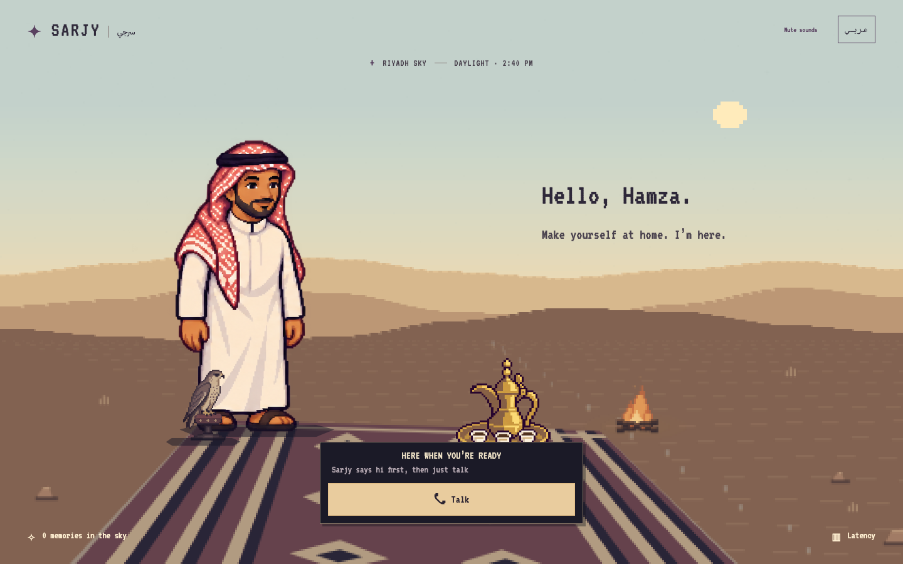
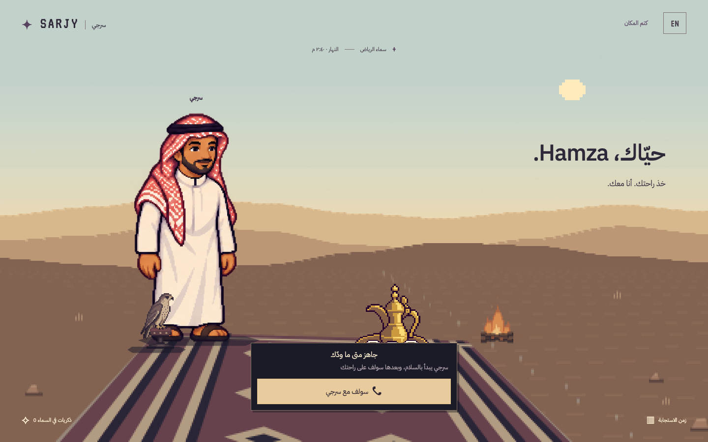
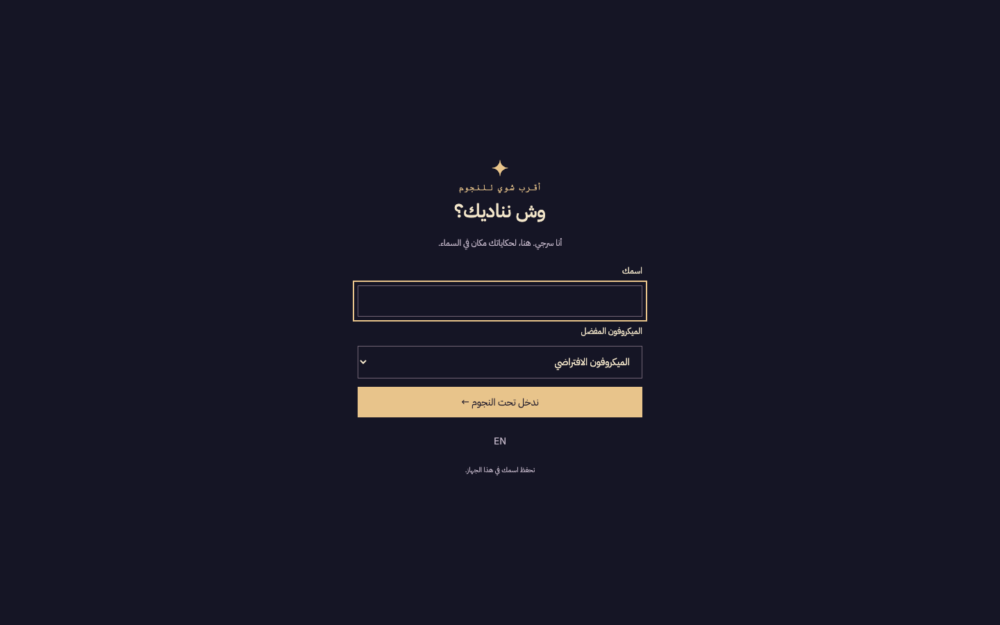
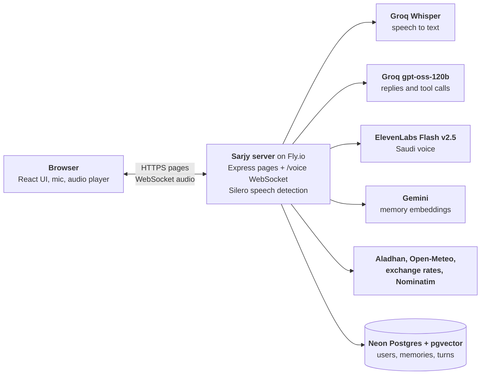

# Sarjy · سرجي

A bilingual Saudi Arabic and English voice assistant you talk to at a pixel-art desert camp under your own local sky. You speak, it answers out loud in the language you used, and everything it learns about you becomes a star overhead.

**Live:** [sarjy.hamz4.com](https://sarjy.hamz4.com) — desktop or mobile, allow the microphone, enter a name, press call.



## What it does

| Brief | How Sarjy does it |
|---|---|
| Listens and responds by voice | The browser mic streams 16 kHz PCM over a WebSocket. The server detects speech with a local Silero model, transcribes with Groq Whisper, answers with Groq `gpt-oss-120b`, and speaks with ElevenLabs Flash v2.5 in a Saudi voice (Hasawi). You can interrupt it mid-sentence. |
| Remembers across sessions | After each turn a small model (`gpt-oss-20b`) pulls lasting facts out of what you said and saves them to Postgres with a Gemini embedding. The next session loads them into the prompt. Say "my favorite color is blue", reload, ask "وش لوني المفضل؟", and it answers "أزرق". |
| Calls real APIs | Prayer times (Aladhan), weather and air quality (Open-Meteo), currency rates, Qibla direction, reverse geocoding (Nominatim). Each result also opens a card on screen. |
| Runs in production | One Node process on Fly.io, Postgres + pgvector on Neon. |

### Why prayer times

Sarjy is built for people in Saudi Arabia, where "when is the next prayer?" is an everyday question. Aladhan answers it for the user's exact location, and the same times drive the scene: the sky moves through Fajr, day, Maghrib and night on the real schedule. Weather follows for the same reason — in Riyadh the useful answer is often "it's 41°C and dusty", so the weather tool also reads air quality and warns about dust.

## The camp

The whole scene is drawn on a canvas and reacts to your voice and Sarjy's: the host, the falcon on its perch, the dallah of gahwa, the fire, the dunes, the moon and the stars. Every memory Sarjy saves streaks in as a new star, and clicking one lets you read or forget it. The interface is fully bilingual and flips to right-to-left in Arabic.

| Arabic, right-to-left | First visit |
|---|---|
|  |  |

## Deep dive: latency

**Metric:** time to first audio (TTFA), from the moment you stop speaking to the moment Sarjy's voice starts. Every turn records a timestamp per stage on the server, the browser reports when playback started, and the latency panel in the app shows the waterfall for the last turn.

**Benchmark:** `pnpm bench` streams recorded English, Arabic and mixed clips in real time into a running server and reports p50/p95 per stage.

### Where the time goes (production)

Measured against [sarjy.hamz4.com](https://sarjy.hamz4.com) on 2026-09-27, 5 runs per clip, p50 in ms:

| Stage | English | Arabic | Mixed |
|---|---|---|---|
| Endpointing (silence window) | 783 | 800 | 800 |
| Transcription (speculative) | 1 | 1 | 124 |
| Memory | 86 | 87 | 87 |
| LLM first token | 4530 | 3075 | 2732 |
| First sentence | 18 | 25 | 25 |
| TTS first audio | 169 | 215 | 178 |
| Network | 99 | 87 | 90 |
| **TTFA** | **5667** | **4516** | **3964** |

The LLM row is Groq's rate limit, not the model. The free-tier key allows 8,000 tokens a minute and one turn uses about 1,700 prompt tokens, so after about four requests a minute Groq makes each call wait for its limit to reset. Unthrottled, the same request's first token arrives in about 0.5 s, which puts TTFA at roughly 1.7 s. Everything except the LLM adds up to about 1.2 s, and most of that is the 800 ms silence window.

### What I tried

| Change | TTFA p50 (en / ar) | Kept? |
|---|---|---|
| Baseline: Speechmatics streaming STT, embed the query for every memory lookup | 4435 / 4038 ms | Replaced |
| Groq Whisper behind a server-side voice detector instead of streaming STT; end of speech detected after 550 ms of silence instead of ~1.6 s | 3278 / 3098 ms | Yes |
| Skip the embedding call: while a user has 40 memories or fewer, put all of them in the prompt instead of embedding the question and searching | 2298 / 2537 ms | Yes |
| Longer silence window (800 ms) so short pauses don't cut people off | 2892 / 2990 ms | Yes, accuracy over speed |
| Speculative transcription: start Whisper 300 ms into a pause, reuse the result if the user stays quiet | 1910 / 2413 ms | Yes |
| ElevenLabs Hasawi voice instead of a warm Cartesia socket | see production table | Yes, a Saudi voice matters more here |

**What didn't work**

- Streaming STT vendors. Speechmatics needed about 1.6 s to decide you had finished, and the free tiers capped concurrent sessions. Soniox had no free tier.
- A loudness threshold for speech detection. Background noise kept starting turns; the Silero model fixed it.
- Whisper on silence or noise invents phrases ("thanks for watching", "اشتركوا في القناة"). Sarjy drops known phantom phrases and low-confidence segments.

## Architecture



One process serves everything from one origin: Express renders the pages and runs the server functions (user, sky, memories), and the same server upgrades `/voice` to a WebSocket for calls. Postgres holds users, memories with their vector embeddings, and every turn with its timings.

### One turn, step by step

```
browser mic (AudioWorklet, 16 kHz PCM)
  -> /voice WebSocket
  -> listen: Silero speech detection, speculative Groq Whisper, transcript cleanup
  -> turn engine: rate limit, cancel the previous turn, load memories
  -> reply: Groq gpt-oss-120b with tools, streamed and cut into sentences
  -> speak: ElevenLabs Flash v2.5, audio + word timings streamed back
  -> browser: Web Audio playback, captions, tool cards, latency waterfall
  -> after the turn: save it, extract new memories in the background
```

### Design choices

- **Raw PCM both ways.** No audio encoding or decoding on the hot path; the browser plays chunks as they arrive.
- **Everything streams.** Speech is transcribed while you pause, the LLM output is cut into sentences as it arrives, and each sentence goes to TTS right away.
- **One cancel switch per turn.** Each turn owns an `AbortController`; interrupting Sarjy aborts every vendor call for that turn, and nothing from a stale turn reaches the browser.
- **One source of truth for messages.** `shared/protocol.ts` defines every socket message; the server validates what the client sends with zod.
- **Vendors are plain functions.** STT, LLM and TTS each sit behind one function in `server/vendors/`, so swapping a vendor touches one file.
- **Pure logic apart from I/O.** Sentence cutting, language detection, Arabic number spelling and timing math are pure functions with tests; network, database and audio stay at the edges.
- **Untrusted input stays data.** Tool results, saved memories and names are passed as JSON data, never as instructions. Sarjy is told never to state a time or fact a tool didn't return, and a forgotten memory can't come back from a late background save.

## Code map

```
shared/protocol.ts        every socket message type, shared by client and server
server/
  main.ts app.ts          boot, Express, /healthz, /voice upgrade, graceful shutdown
  config.ts env.ts        named tunables, validated environment
  voice/listen/           speech detection, transcription, cleanup, language detection
  voice/reply/            one turn, the LLM loop, system prompt, sentence cutting
  voice/speak/            TTS streaming, speakable Arabic numbers, canned phrases
  voice/session/          one socket's session and its turn engine
  vendors/                one plain function per outside service (STT, LLM, TTS)
  tools/                  LLM tools and the registry that runs them
  memory/                 save, search and extract memories
  db/ users/              Drizzle schema, user lookup by cookie
src/
  routes/                 data loading for the page
  features/voice/         mic, socket, audio player, call state, captions
  features/scene/ sky/    canvas desert, sky phase from prayer times
  features/memories/      constellation and memory dialog
  features/tools/         tool result cards
  features/*              camp screen, welcome, sounds, latency panel, dev preview
test/                     mirrors the source tree
bench/                    latency benchmark and its recorded clips
drizzle/                  SQL migrations
```

## Run it locally

You need Node 22+, pnpm, a Postgres database with pgvector (Neon's free tier works), and keys for Groq, Gemini and ElevenLabs.

```bash
cp .env.example .env    # fill in DATABASE_URL, GROQ_API_KEY, GEMINI_API_KEY, ELEVENLABS_API_KEY
pnpm install
pnpm migrate            # apply the migrations in drizzle/
pnpm dev                # web on :3000, voice server on :8787
```

| Command | What it does |
|---|---|
| `pnpm check` | Biome lint and format, TypeScript |
| `pnpm test` | unit and integration tests (uses the database in `.env`) |
| `pnpm test:live` | tests that call the real vendors |
| `pnpm bench:clips` / `pnpm bench` | record the benchmark clips, then measure TTFA per stage |
| `pnpm build` / `pnpm start` | production build and server |

Deploys run `fly deploy`; the Fly release step applies migrations before the new machine starts.

## Next

1. Replace the fixed silence window with a turn-detection model, so a finished sentence ends the turn in about 200 ms instead of 800 ms.
2. Start the LLM on the speculative transcript instead of waiting for the final one.
3. Keep one ElevenLabs socket warm per session instead of opening one per turn.
4. Measure a region closer to Gulf users against Fly `iad` (US East), where it runs today.
